# Figures — M1 exploration (28 Sep 2026)

Screenshots taken by Chibugo in the Google Earth Engine Code Editor while running the scripts in `gee/`. They are **visual exploration only**: no water classification, flood area or accuracy has been measured yet. fig01 was cropped to remove account details.

**Attribution:** Contains modified Copernicus Sentinel data (2026), processed in Google Earth Engine (COPERNICUS/S1_GRD). Basemap labels © Google.

**How to read radar pictures:** dark = quiet echo (smooth water, like the lagoon); bright = loud echo (buildings). The red, yellow or orange box is our Lekki study area.

---

### fig01 — The flood-day radar picture (30 June 2026, 06:29 Lagos time)
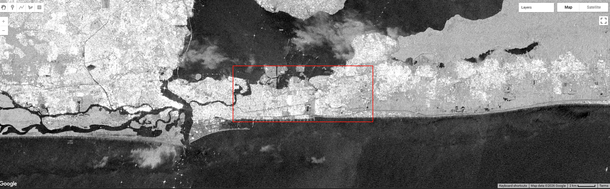
Sentinel-1D, VV, dB (−25 black to 0 white). Lagos Lagoon (top) and creeks are black. The sea (bottom) is dark grey. Lekki and VI are bright. The pale "cloud-like" blobs on the lagoon and sea are not clouds (radar sees through cloud); they are probably wind or rain roughening the water. Script: `gee/01_first_look.js`.

### fig02 — The 18 June 2026 picture (for comparison)
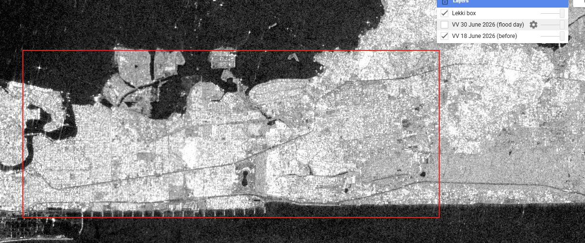
Same satellite and lane, 12 days earlier. By eye it looks almost the same as 30 June on land. Script: `gee/01_first_look.js`.

### fig03 — Change colours: 18 June vs 30 June
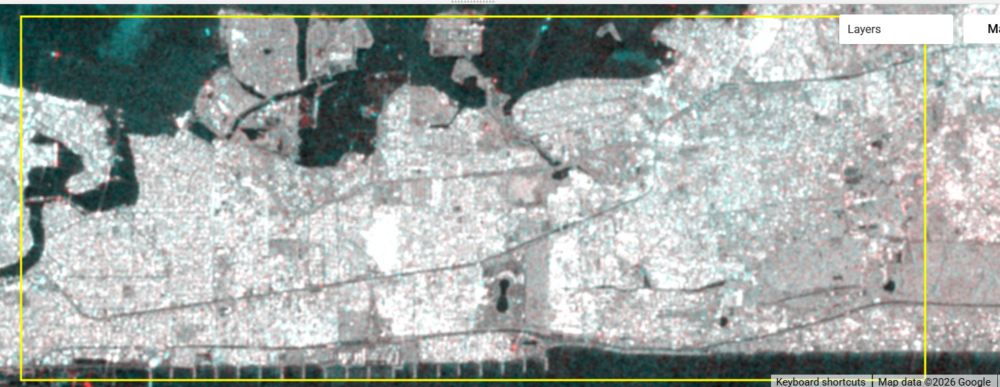
Red = 18 June, green + blue = 30 June. Grey = no change; red = darker on 30 June; cyan = brighter on 30 June. The lagoon is cyan (roughened water). Land is mostly grey, so there is little difference, probably because **both dates were already in the flooded/wet period**. Script: `gee/02_change_view.js`.

### fig04 — A failure example: an empty search
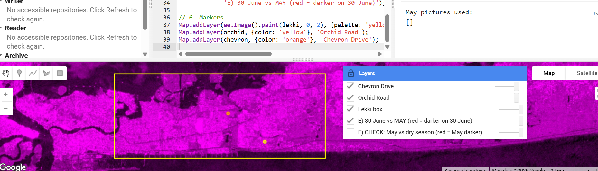
The May 2026 search for Sentinel-1D on our lane found **zero pictures** (Console: `[]`), so the colour recipe was missing an ingredient and turned magenta. Lesson: code must stop with a clear message when a search is empty. Script: `gee/04_may_baseline.js` (v1).

### fig05 — Change colours: 30 June vs July 2026
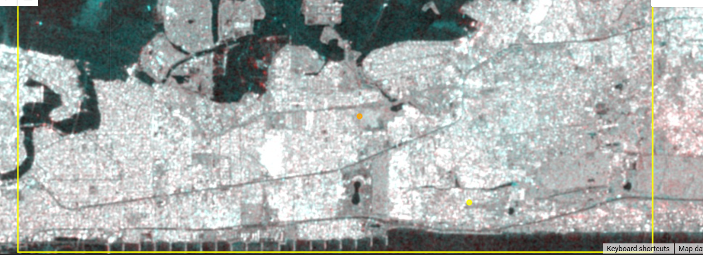
Red = July reference, green + blue = 30 June. Mostly grey with scattered red and cyan specks, so 30 June and July look similar. Script: `gee/05_after_baseline_s1d.js`.

### fig06 — Change colours: 30 June vs August 2026
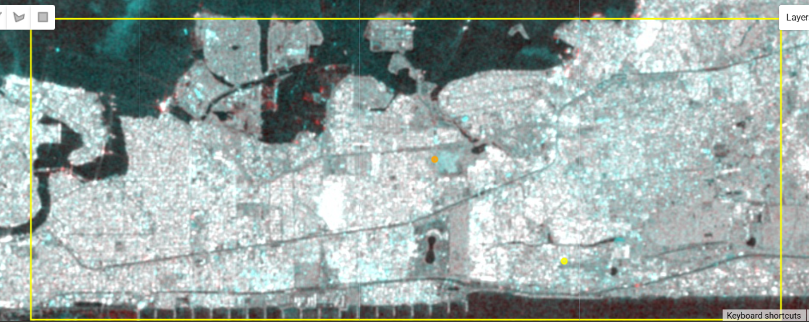
Same recipe with an August reference. More cyan over built-up land: 30 June was **brighter** than August. Script: `gee/05_after_baseline_s1d.js`.

### fig07 — Time series: radar echo at three spots, June–September 2026 ⭐
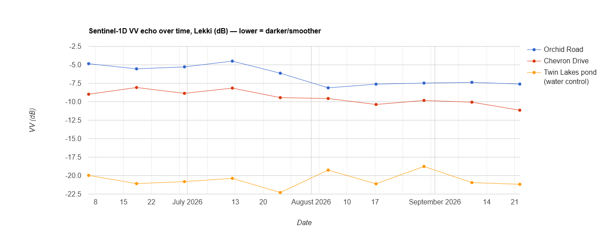
One dot per Sentinel-1D pass (every 12 days). Numbers: `evidence/time_series_2026-09-28.csv`.
- **Orange (Twin Lakes pond):** always about −19 to −22 dB, i.e. always water. The "control" confirms the method works.
- **Blue (Orchid Road):** about −5.0 dB on average from 6 Jun to 12 Jul, then about −7.6 dB from 5 Aug to 22 Sep. A drop of about 2.6 dB: Orchid was *brighter* during the wet/flooded weeks.
- **Red (Chevron Drive):** a smaller, gradual decline.
Script: `gee/06_time_series.js`. Interpretation: evidence/TIME_SERIES_2026-09-28.md.

### fig08 — The detective test: an open plot added (green line)
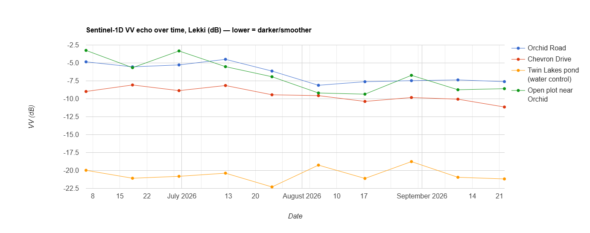
Green = an empty plot near Orchid (location in fig09). Chart image and numbers exported from GEE: `evidence/time_series_open_plot_2026-09-28.csv`. Like Orchid, it is **louder** in June–mid-July (≈ −4.5 dB) than in August–September (≈ −8.5 dB). Flood water on open ground would normally be *quieter*, so this points to **wet ground** rather than calm standing water at the pass times. Standing water is not ruled out (rain-roughened water or grass can look bright).

### fig09 — Where the open plot is
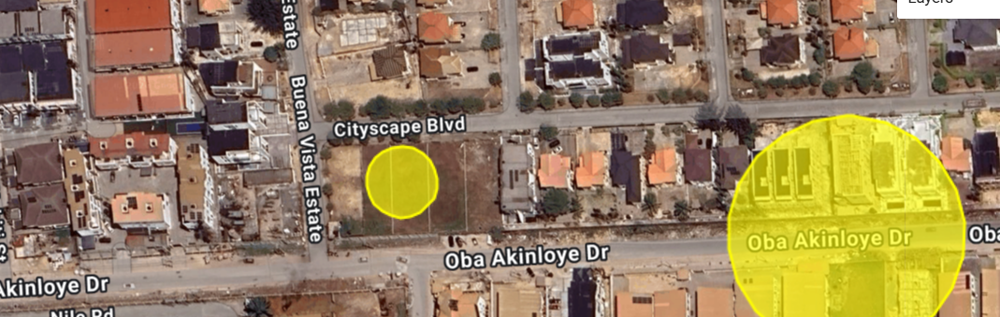
The small yellow circle (15 m radius) sits inside an empty plot between Cityscape Blvd (north), Buena Vista Estate (west) and Oba Akinloye Dr (south). The big circle is the Orchid Road spot (50 m radius). Imagery © Google / Airbus / Maxar.

---

## M2 — what the recipe produces

### fig10 — The two output files, side by side (1 km square around Orchid)
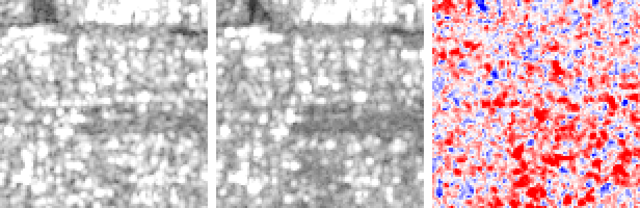
**Left:** flood day, 30 June 2026 (VV). **Middle:** dry reference, August 2026 median (VV). **Right:** difference, flood day minus August (red = louder on the flood day, blue = quieter, white = same; ±6 dB). Grey panels: black = quiet (≤ −25 dB), white = loud (≥ 0 dB). The left panel is slightly brighter overall and the right panel is mostly red: 71% of pixels were louder on the flood day (median +1.16 dB). Made by `scripts/quicklook.py` from the files written by `src/preprocess.py` (receipt: evidence/runs/). Contains modified Copernicus Sentinel data (2026), processed in Google Earth Engine.

### fig11 — The 5 km Lekki square (M3 study area, S22)
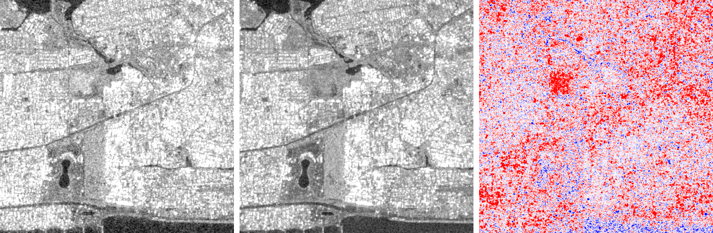
Same layout and colours as fig10, for configs/case_lekki5km.json (500 × 500 px of 10 m; north is up). Dark shapes in both grey panels (lagoon edge top-left, a winding channel, ponds, a keyhole-shaped lake lower-left, a dark strip along the bottom) are dark on **both** dates, so they are not flood signals. The bottom strip is not "always water" in JRC GSW 1.4, so it may be smooth bare ground (e.g. sand fill), which radar also shows dark: dark does not always mean water (to be checked). Difference panel: widespread louder pixels (20% louder by >3 dB VV, median +0.99 dB) plus a compact, strongly louder block upper-left of centre; cause unknown (not interpreted yet). Made by `scripts/quicklook.py --case lagos-lekki-5km-2026-06-30 --zoom 1`. Contains modified Copernicus Sentinel data (2026), processed in Google Earth Engine.

### fig12 — Wet control: 10 Sep 2026 vs August (no reported flood)
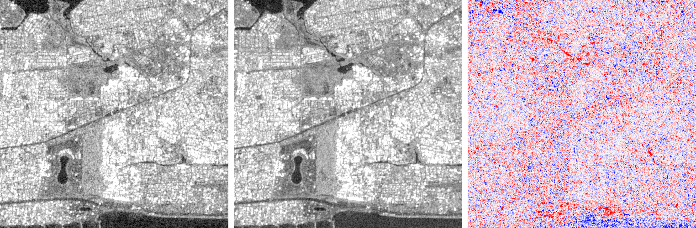
Same layout as fig11. 10 Sep had about the same rain in the 48 h before the pass as the flood day (IMERG 49.4 vs 48.2 mm), but the difference panel is an even mix of red and blue grain (7.8% louder, 5.5% quieter by >3 dB). Compare with fig11 (20.4% louder, 3.7% quieter). See evidence/M3_CONTROL_TEST_2026-11-04.md. Contains modified Copernicus Sentinel data (2026), processed in Google Earth Engine.

### fig13 — Dry control: 22 Sep 2026 vs August
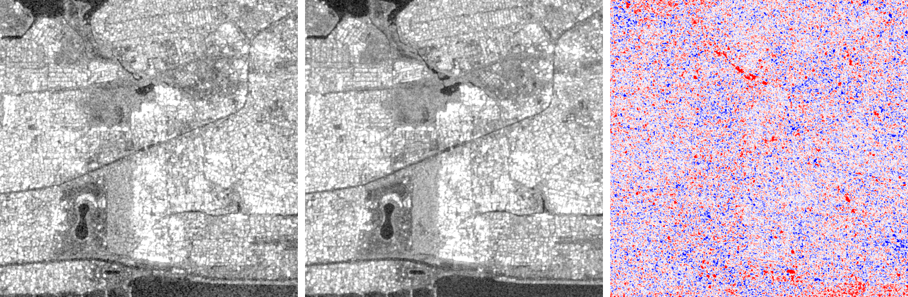
The "nothing happened" baseline: 7.3% louder and 7.3% quieter by >3 dB, median change +0.02 dB. This is the radar grain level. Contains modified Copernicus Sentinel data (2026), processed in Google Earth Engine.

### fig14 — Practice and test areas (S25)
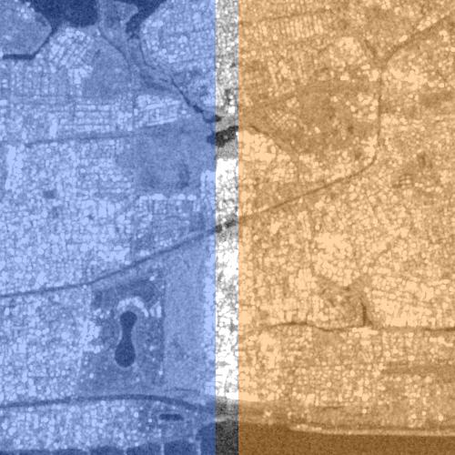
5 km Lekki square, August reference VV in grey; north is up. **Blue (west) = practice area** (118,500 px): rules may be tuned here. **Orange (east) = test area** (119,000 px): checked once, never tuned on; it holds Orchid and most news-named streets. **Plain grey strip = 250 m gap** (12,500 px) used by neither, so 50 m smoothing windows never mix the two. Made by `scripts/split_map.py`. Contains modified Copernicus Sentinel data (2026), processed in Google Earth Engine.

### fig15 — Pixel labels: flood day vs wet and dry control days (S26)
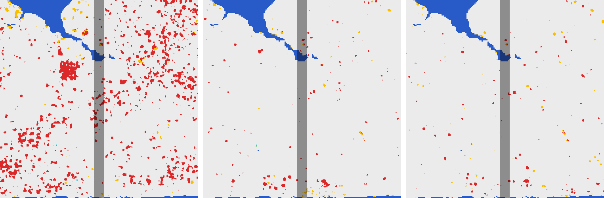
Left: 30 Jun 2026 (flood). Middle: 10 Sep (equally rainy, no reported flood). Right: 22 Sep (dry). Each panel is the 5 km Lekki square, north up; the darker vertical strip is the gap between the practice (west) and test (east) areas. Colours: **red = land got louder** (by > 3.5 dB after 50 m smoothing), **dark blue = always water** (JRC), **yellow = can't tell**, light blue-green = new dark water (almost none), light grey = no change, black = not observed (none). Red is widespread on the flood day and sparse on both controls, on both sides of the split. See evidence/M3_LABELS_2026-11-06.md. Contains modified Copernicus Sentinel data (2026) and JRC Global Surface Water (EC JRC/Google), processed in Google Earth Engine.

### fig16 — Do the same spots light up again? 30 Jun vs 12 Jul 2026
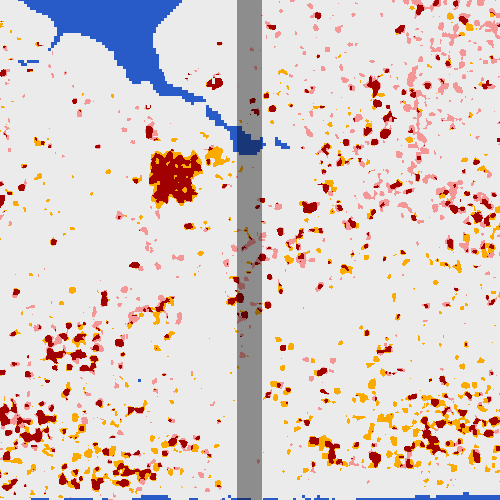
5 km Lekki square, north up, gap strip dimmed. **Dark red = 'land got louder' on both 30 Jun and 12 Jul** (both vs the August median); light red = 30 Jun only; orange = 12 Jul only; blue = always water (JRC). 12 Jul had even more rain (IMERG 84 mm in 48 h). On the test side 43% of 30 Jun red pixels are red again (chance 9%). See evidence/M3_PERSISTENCE_AND_REFERENCE_2026-11-07.md. Contains modified Copernicus Sentinel data (2026) and JRC Global Surface Water, processed in Google Earth Engine.
